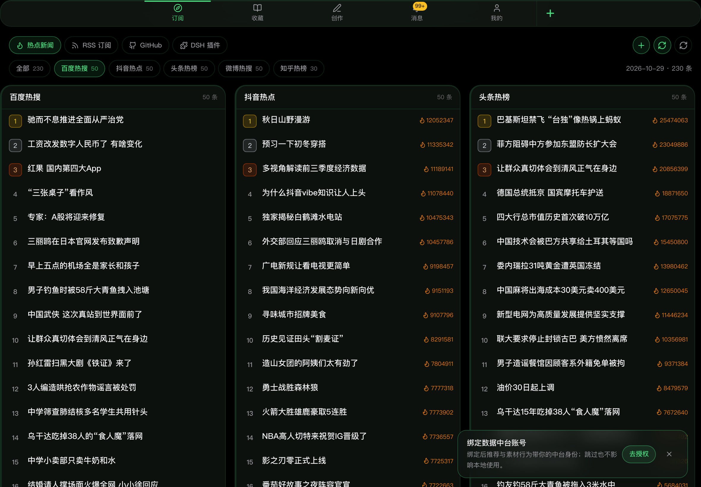
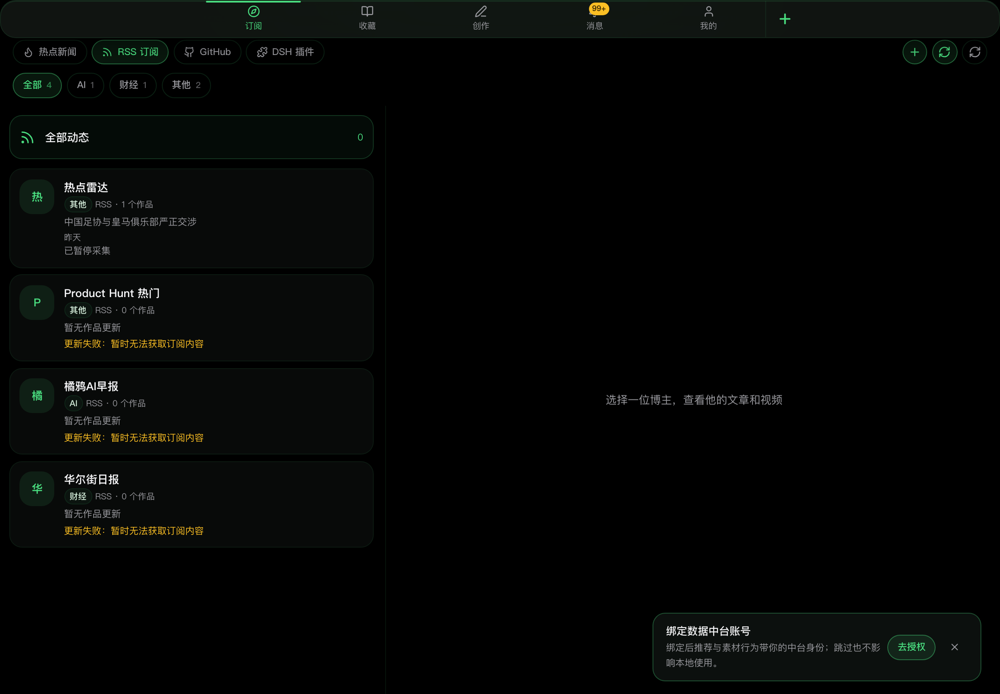
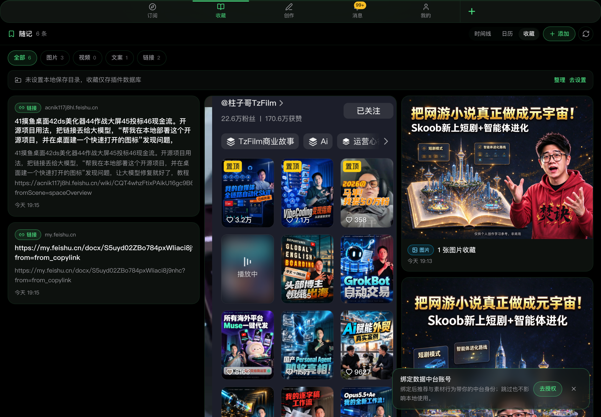
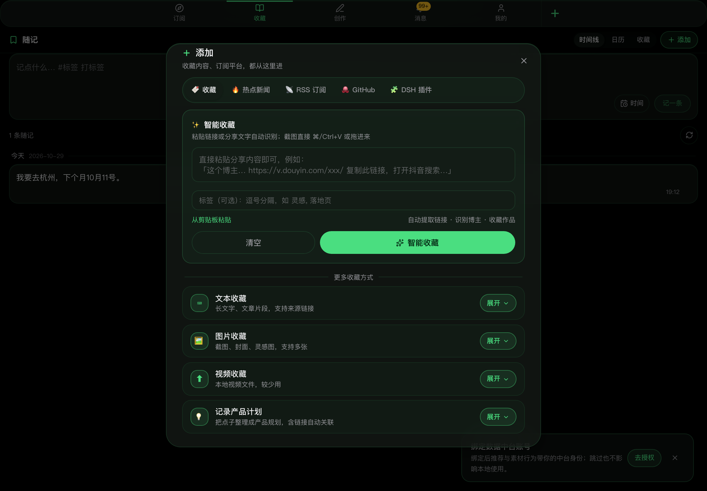
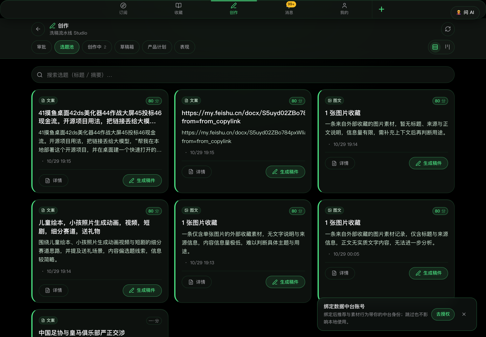
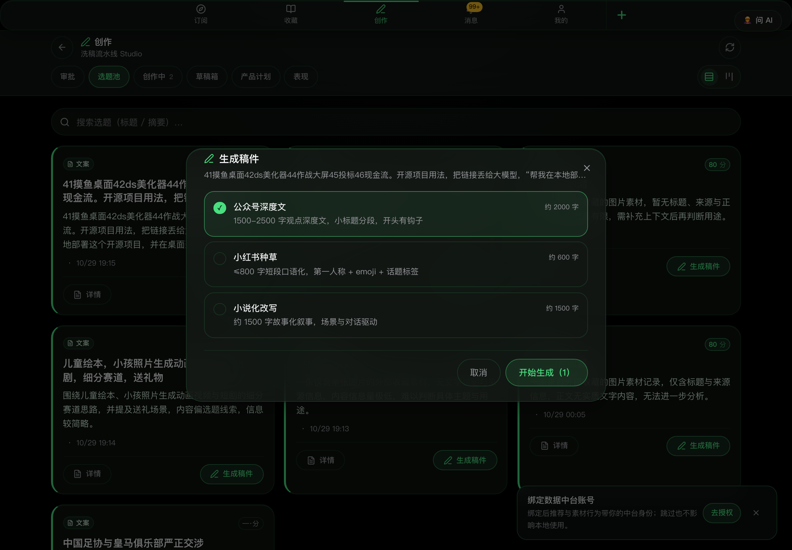
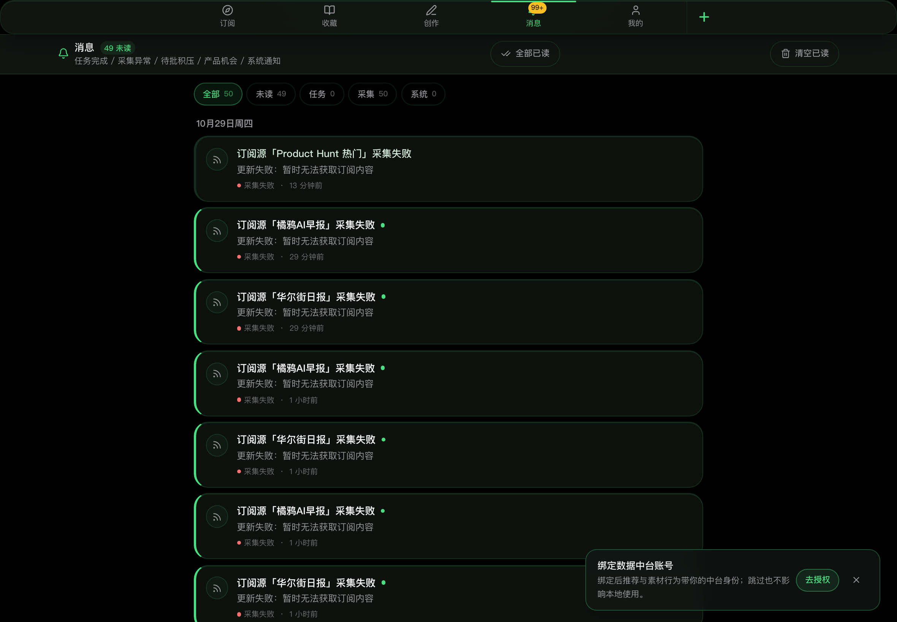
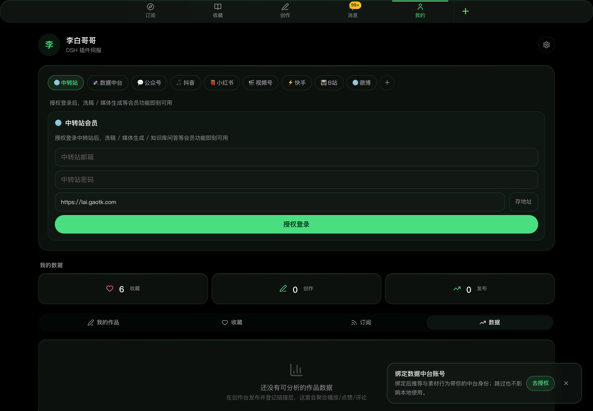

<div align="center">

# Superman

**跑在 DeepSeek Harness 里的内容工作台插件**

热点/订阅发现 → 治理审批 → AI 创作 → 发布 → 数据复盘，一条本地闭环

[](https://github.com/deepseek-ai)


</div>

---

## 这是什么

Superman 是 **DSH（DeepSeek Harness）的独立插件**：装进 DSH 后，侧栏多出一个「工作台」面板，
把「找选题 → 出成稿 → 发出去 → 看数据」这条内容流水线全部装进本地。

- **零配置**：数据默认落在本机内嵌库（PGlite），不依赖外部服务；想换 Postgres 改一行连接串即可
- **模型复用宿主**：默认直接调 DSH 自带的 DeepSeek（`ctx.llm`），不用另填 API Key
- **本地优先**：收藏的图/视频可以直接落进你自己的 Obsidian vault，数据始终是文件

## 功能一览

### 订阅聚合：热点 + RSS + GitHub + 插件目录



- 几十个热榜渠道（社会 / 科技 / 财经 / 国际等），**默认全开、勾选即采集**，可逐个取消；今天没数据或平台覆盖不足会自动补采一轮
- 二级导航统一：`全部 N | 微博 50 | 知乎 30 …`，默认「全部」，滚动与高亮联动
- 每个渠道失败互相隔离，不拖垮整块看板



- 三栏阅读器（订阅源 / 作品列表 / 正文），支持 RSS、B 站、抖音等
- 订阅源自动分类：**AI / 财经 / 科技 / 开发 / 新闻 / 生活 / 其他**（关键词标签库，可自己扩）
- 一键「立即抓取」、失败源会标记原因

### 收藏夹 / 随记：截图、链接、视频都能收



- 智能收藏：粘贴分享文案、`⌘V` 截图、拖入视频 → 自动识别归类为 **图片 / 视频 / 文案 / 链接**
- 瀑布流 3–4 列，视频自动抽首帧当封面，图片显示首图 + 张数角标
- 支持编辑标题/备注、删除；随记支持时间线 / 日历视图



**落盘到本地目录（Obsidian vault）**：

```text
<你的目录>/
├── 那条收藏-20261029-193012.md     # frontmatter + 正文，![[attachments/…]] 内嵌
└── attachments/2026-10/
    ├── 1793199904489_abc.png       # 图片原文件
    └── 视频.poster.jpg / 视频.mp4   # 视频首帧封面 + 原视频
```

### 创作流水线：策划 → 成稿 → 草稿箱





- 从选题池一键生成：**公众号深度文 / 小红书种草 / 小说化改写**，可多平台并行
- **两段式生成**：先出策划案（切入角度 / 标题候选 / 分节大纲），再按大纲写正文；
  策划段失败会自动降级为单段，不阻塞出稿
- **平台化产物**：公众号带摘要 + 备选标题，小红书带话题标签 + 封面文案，小说化带章节名
- **原创度红线**：与原文 bigram 相似度 > 0.5 自动带降重指令重写一次，仍超标落 `needs_review` 等人工终审
- 草稿箱可对照原文、看相似度、采纳、导出 Markdown

### 发布与复盘

- **公众号**：API 直接送进草稿箱（配好 AppID/AppSecret 即可）
- **抖音 / 小红书**：视频走 SAU 执行器发布
- **纯文案**：一键复制平台格式化文案（标题+正文+话题）+ 打开创作后台 + 回填链接登记
- 登记后进「表现」：按链接追踪播放/点赞/评论 7 天曲线，爆款触发提醒

### 消息中心



- 事件型通知：任务完成、采集失败、待批积压、产品机会、系统通知
- 分类筛选（全部/未读/任务/采集/系统）、全部已读、清空已读
- 采集失败按「订阅源 × 6 小时」去重，不会刷屏

### 我的：平台账号 + 数据



- 平台账号（中转站 / 数据中台 / 公众号 / 抖音 / 小红书 / 视频号 / 快手 / B站 / 微博）
- 我的数据：收藏、创作、发布统计 + 作品/收藏/订阅/数据子标签
- 右上角齿轮收起小设置菜单：收藏保存目录 / 服务与同步 / 更多设置 / 退出登录

## 架构

```text
src/hotboard/      热榜采集（纯 TS，零外部进程）：channels.ts 增删渠道只动一个文件
src/plugin/        DSH 插件本体
  host/            /s/api/* 业务 API、调度器、agent 工具（superman_*）、H5 静态伺服
  public/app/      构建产物（DSH 面板加载的前端）
kernel/core/       自包含业务内核：治理/订阅/阅读器/收藏/流水线/发布追踪/通知/产品计划
kernel/server/     依赖闭包（存储、AI 适配、平台账号、vault 导出）
vendor/rsshub/     RSSHub 编译产物（import 即用）
```

数据流：

```text
采集(热榜/RSS) ─┐
                ├─→ articles(待批) ──审批──→ 选题池 ──生成──→ drafts ──采纳──→ 发布 ──→ published_posts(追踪)
收藏(图片/文本) ─┘        │                    │                 │
                       通知中心            产品计划              Obsidian vault
```

- **存储**：默认 PGlite（`~/.dsh/superman/pgdata`），可切 Postgres（`SUPERMAN_DATABASE_URL`）
- **模型**：DSH 宿主模型桥（`dsh://llm`）优先；也支持应用内自填 OpenAI 兼容 endpoint
- **调度器**：默认只跑事件驱动任务（保存即采集、生成即执行），周期任务可按需开启

## 快速开始

```bash
# 1. 装进 DSH profile（link 本地仓库即可）
#    profile/package.json
"dependencies": {
  "superman": "link:/path/to/superman-dsh-plugin"
}

# 2. 重启 DSH —— 插件自动挂载
#    /s/api/*  业务 API
#    /s/app/*  H5 前端（侧栏「工作台」面板）
#    superman_* agent 工具（可让 AI 帮你审稿/生成）
```

首次使用建议：

1. 「订阅 → 热点新闻」里勾选要看的平台（默认全选）
2. 「我的 → 设置菜单 → 收藏保存目录」填一个本机绝对路径（Obsidian vault 子目录最顺手）
3. 「我的 → 平台账号」按需授权公众号 / 抖音 / 小红书

## 开发

```bash
pnpm install
pnpm type-check     # TypeScript 全量检查
pnpm build          # 构建 dist/plugin（host + H5 产物 + 迁移）

pnpm hotboard:sync  # 单独跑一轮热榜采集（调试渠道用）
```

> H5 前端源码在上游仓库 `FeedFuse` 的 `src/h5`，构建产物同步到本仓库 `src/plugin/public/app`。

## 设计取舍

- **不做热补丁**：host 改动必须重新构建、重启 DSH 才生效；只在 H5 侧做静态资源热更新
- **不做双跑**：插件调度器与旧 Next.js worker 互斥，避免同一批任务被消费两次
- **原创度优先**：洗稿默认跑相似度校验，宁可在草稿箱多一次人工审查，不产出洗稿风险内容
- **文件优先**：收藏的媒体与笔记可以直接是本地文件，Obsidian / iCloud / Git 都能接管

## Roadmap

- [ ] 视频线：文案 → 口播稿/分镜 → TTS 配音 → 合成 → SAU 发布抖音/小红书
- [ ] 创作自检闭环：长度/结构/标签清单校验，不合格自动修订一轮
- [ ] 发布后复盘：3/7 天数据回判，反哺选题池
- [ ] 平台技能库可编辑：把三个平台的 prompt 从代码搬到可编辑配置
- [ ] 订阅源健康管理：失败源暂停、换地址建议

## 致谢

- 灵感与部分流程设计参考 [Easel](https://github.com/ZJU-REAL/Easel)（社媒运营助手：技能化 prompt、两段式创作、发布复盘）
- RSS/博主订阅基于 [RSSHub](https://github.com/DIYgod/RSSHub)
- 热榜数据模型沿用 TrendRadar 的表结构，看板/agent 工具链路零改动复用

## License

[MIT](LICENSE)
